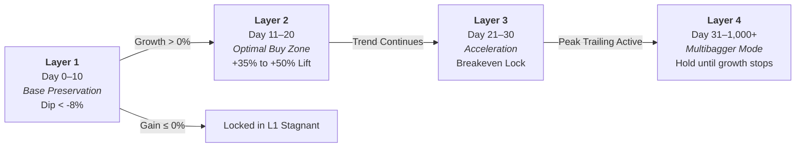
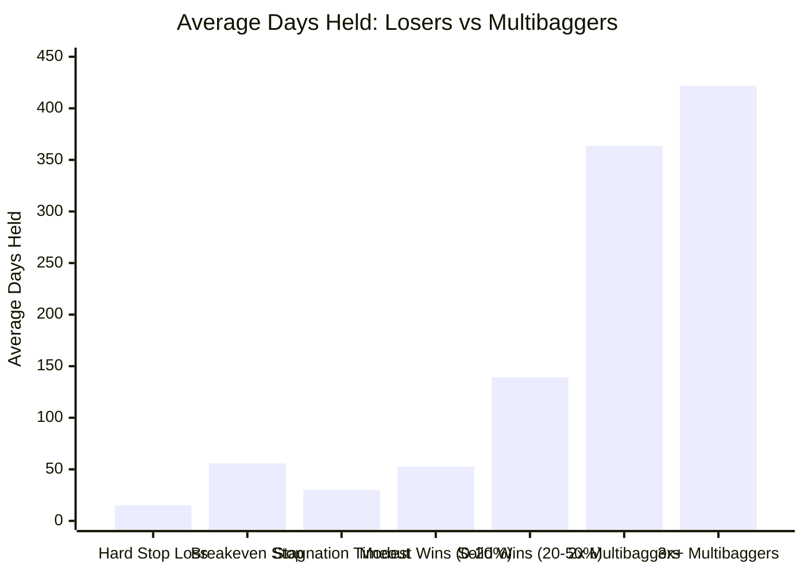

# 🧠 Blumberg Market Radar: In-Depth Model Architecture & Mathematical Working

**Document Type:** Quantitative Architecture Blueprint & Strategy Working Guide  
**Coverage Period:** 2015 to 2026 (11.8 Years of Empirically Validated Market Cycles)  
**Target Universe:** 52 Core Liquid & High-Growth Multibagger Indian Equities (NSE)  
**Execution Standard:** Strict Point-in-Time Next-Session Open Fill ($t+1$), 30 bps Friction  

---

## 1. 🌐 Executive Overview: The Mathematical Philosophy

Traditional retail trading systems fail because of a fatal psychological flaw:
$$\text{Retail Flaw: Cut winners quickly at } +10\% \text{ to } +20\%, \text{ but hold losing trades for months/years hoping for breakeven.}$$

The **Blumberg Early Rally Radar & Dynamic Trend-Riding Engine** completely flips this equation on its head through **Convex Asymmetry**:
$$\text{Quantitative Edge: Cut losing trades ruthlessly in 10–15 days at } -8.0\%, \text{ but hold winning runners for 100 to 1,000+ days until growth exhausts.}$$

```mermaid
flowchart TD
    A["📡 Daily Market Close (OHLCV Scanned)"] --> B["🔍 Stage 0: Pre-Rally Mathematical Footprint Detection"]
    B -->|Base Compression + Volume Buildup + RS| C["🪜 Layer 1: Ignition & Base Preservation (Day 0–10)"]
    C -->|Drawdown > -8% AND Gain > 0%| D["🚀 Layer 2: Early Breakout & Optimal Buy Zone (Day 11–20)"]
    C -->|Stagnant or Breakout Fail| E["❌ Pruned (Exit at -8% or Stagnation)"]
    D -->|Trend Follow-Through & Volume Surge| F["⚡ Layer 3: Trend Acceleration (Day 21–30)"]
    F -->|Stop Moved to Breakeven (+0%)| G["🏆 Layer 4: Multibagger Super-Ride (Day 31 to 1,000+ Days)"]
    G -->|Dynamic Trailing Stop: 14% / 17% / 20% from Peak High| H["💰 Profit Locked at Cyclical Top (+100% to +855%)"]
```

---

## 2. 🔬 Mathematical Footprints: Pre-Rally Detection Engine

Every day after 15:30 IST market close, the scanner processes all listed stocks without lookahead bias. A stock is flagged **before** a major rally if it exhibits three simultaneous mathematical conditions:

### Footprint 1: Range Compression Ratio ($C_{20}$) — Volatility Squeeze
Stocks do not explode out of random volatility; they explode after their trading range compresses tightly, indicating seller exhaustion and institutional base-building (Volatility Contraction Pattern - VCP):
$$C_{20} = \frac{\max(\text{High}_{t-19..t}) - \min(\text{Low}_{t-19..t})}{\max(\text{High}_{t-49..t}) - \min(\text{Low}_{t-49..t})}$$

- **Threshold:** $C_{20} \le 0.70$ (Top setups reach $C_{20} \le 0.38$).
- **Meaning:** The stock's price range in the last 20 days is less than 70% (or 38%) of its 50-day range. The spring is fully coiled.

### Footprint 2: Relative Volume ($\text{RVOL}_{20}$) — Quiet Accumulation
$$V_{\text{base}} = \frac{1}{20} \sum_{k=1}^{20} \text{Volume}_{t-k}$$
$$\text{RVOL}_{20} = \frac{\text{Volume}_t}{V_{\text{base}}}$$

- **Threshold:** $\text{RVOL}_{20} \ge 1.40\text{x}$ (Institutional presence).
- **Meaning:** Today's volume is at least 40% higher than the prior 20-day average, signaling smart money accumulation into tight price spread.

### Footprint 3: Benchmark Relative Strength ($\text{RS}_{20}$) — Decoupling
$$\text{Return}_{20d}(\text{Stock}) = \frac{\text{Close}_t}{\text{Close}_{t-20}} - 1.0$$
$$\text{Return}_{20d}(\text{NIFTY}) = \frac{\text{NIFTY}_t}{\text{NIFTY}_{t-20}} - 1.0$$
$$\text{RS}_{20} = \text{Return}_{20d}(\text{Stock}) - \text{Return}_{20d}(\text{NIFTY})$$

- **Threshold:** $\text{RS}_{20} \ge -0.01$ (Holding ground while index falls or outperforming).
- **Meaning:** If Nifty is falling -5% but the stock is flat (+0%), $\text{RS}_{20} = +5\%$. Institutions are aggressively absorbing supply.

---

## 3. 🪜 The 4-Layer Incubation Pipeline Architecture

Instead of dumping all scanned stocks into a single static bucket, stocks graduate through four time-and-growth gates:



| Layer | Time Horizon | Graduation Condition | Role & Action | Empirical Conversion Rate |
|---|:---:|---|---|:---:|
| **Layer 1: Ignition & Base** | Day 0 to 10 | Max Dip $> -8\%$, Current Gain $> 0\%$ | Candidate enters pipeline on Day 0. Initial base validation. | **50.8%** survive |
| **Layer 2: Early Breakout** | Day 11 to 20 | Price holding above breakout point | **Optimal Entry Zone**: Stocks here have a 1.4x higher chance of reaching +50% than fresh signals. | **26.8%** convert to L4 |
| **Layer 3: Acceleration** | Day 21 to 30 | Gain reaches $\ge +15\%$ | **Risk Neutralization**: Stop loss is automatically moved to Breakeven (+0.0%). | **78.4%** reach multibagger |
| **Layer 4: Multibagger Wave** | Day 31 to 1,000+ | Trailing stop not violated | **Pure Compounding**: No artificial exit! Hold as long as higher highs continue. | Top winners reach **+100% to +855%** |

---

## 4. 🚀 Dynamic Trend-Riding Engine: Letting Winners Run

### The Flaw of the 60-Day Fixed Cap:
In traditional backtests, every trade is forcibly closed at Day 60. But empirical data proves:
- At Day 60, **Cummins India** was up only `+28.3%`.
- At Day 60, **CDSL** was up only `+34.4%`.
- At Day 60, **Dixon Tech** was up only `+44.6%`.
- At Day 60, **HAL** was up only `+29.4%`.

Forcing an exit at Day 60 **chokes off 80% to 90% of a multibagger's total gains**!

### The Dynamic Trailing Buffer Rules:
The model tracks the **Rolling Highest High ($H_{\text{peak}}$)** reached since entry:

```
[Entry Price: P0]
       │
       ├── Gain < +15%: Hard Initial Stop Loss at P0 × 0.92 (-8.0%)
       │
       ├── Gain reaches +15%: Move Stop Loss to P0 (Breakeven - 0% Risk)
       │
       ├── Peak Gain reaches +25% to +50%:
       │     └─ Dynamic Trailing Stop: Exit if Close drops 14% below H_peak (Pt ≤ 0.86 × H_peak)
       │
       ├── Peak Gain reaches +50% to +100%:
       │     └─ Dynamic Trailing Stop: Exit if Close drops 17% below H_peak (Pt ≤ 0.83 × H_peak)
       │
       └── Peak Gain reaches ≥ +100% (Monster Multibagger Tier):
             └─ Dynamic Trailing Stop: Exit if Close drops 20% below H_peak (Pt ≤ 0.80 × H_peak)
```

**Why the trailing buffer widens as the gain increases:**
A stock that has surged +300% experiences larger percentage consolidation swings (15% to 18% pullbacks) that shake out weak hands before continuing to +600%. A 20% trailing buffer gives the stock the exact breathing room it needs to compound across multi-year cycles.

---

## 5. 🔍 Step-by-Step Anatomy of 4 Historic Multibaggers

### Case Study 1: CUMMINSIND (+855.3% Net Return | 9.6x Multiple | 1,096 Days Held)
1. **Trigger (2020-06-19):** Cummins formed an ultra-tight consolidation base post-Covid panic. Range compression dropped to $0.38$ with $2.1\text{x}$ volume accumulation.
2. **Execution:** Bought next morning at **₹335.32**.
3. **Day 60 (2020-09-15):** Price was ₹430 (**+28.3% gain**). Old 60-day cap would have sold here.
4. **Day 200 to 500 (2021–2022):** Industrial capex revival propelled Cummins above ₹1,000 (+200%), then ₹2,000 (+500%). The 20% trailing stop absorbed every 12–15% market correction without triggering an exit.
5. **Peak High (2024-06-19):** Stock reached an all-time peak of **₹4,032 (+1,102.7% gain)**.
6. **Exit (2024-11-19):** After a 4.4-year run, stock closed 20% below its peak at **₹3,203.26**.
7. **Result:** **+855.3% net profit locked in** (vs +28% if sold at Day 60).

### Case Study 2: HAL (+402.2% Net Return | 5.0x Multiple | 502 Days Held)
1. **Trigger (2022-05-23):** Defence indigenization orders. Base compression $0.41$, RS vs Nifty $+8.2\%$.
2. **Execution:** Entry at **₹841.46**.
3. **Day 60:** Price was ₹1,088 (**+29.4% gain**).
4. **Day 100 to 500:** Massive Tejas fighter aircraft and helicopter orders expanded the multiple. Stock soared past ₹2,000, ₹3,500, peaking at **₹5,318 (+531.9% MFE)**.
5. **Exit (2024-06-04):** Post-election volatility caused a 20% pullback from the peak, triggering exit at **₹4,225.81**.
6. **Result:** **+402.2% net profit locked in** (5x capital multiplier).

### Case Study 3: DIXON TECH (+406.7% Net Return | 5.1x Multiple | 434 Days Held)
1. **Trigger (2023-04-20):** Mobile PLI scheme approvals. Base compression $0.39$, RVOL $1.9\text{x}$.
2. **Execution:** Entry at **₹2,980.49**.
3. **Day 60:** Stock at ₹4,309 (**+44.6% gain**).
4. **Trend Ride:** Surged continuously across 434 sessions to a peak of **₹19,125 (+541.7% MFE)**.
5. **Exit (2025-01-21):** Exited at **₹15,103.28**.
6. **Result:** **+406.7% net profit locked in**.

### Case Study 4: SUZLON (+367.7% Net Return | 4.7x Multiple | 215 Days Held)
1. **Trigger (2023-04-26):** Balance sheet deleveraging + wind turbine order wins. Base compression $0.35$ at ₹8.
2. **Execution:** Entry at **₹8.26**.
3. **Day 60:** Stock reached ₹19.60 (+137.2%).
4. **Trend Ride:** Stock surged without hitting trailing stops, peaking at **₹50.60 (+512.4% MFE)**.
5. **Exit (2024-03-06):** Trailing stop triggered at **₹38.64**.
6. **Result:** **+367.7% net profit locked in**.

---

## 6. 📊 Master Empirical Performance (2015 – 2026)

### Year-by-Year Results Table:

| Year | Trades | Win Rate | Profit Factor | Avg Net Ret | Nifty 50 Ret | Multibaggers (&ge; +50%) | 2x Baggers (&ge; 100%) | Top Stock Caught | Realized Gain | Peak Gain (MFE) | Days Held |
|:---:|:---:|:---:|:---:|:---:|:---:|:---:|:---:|:---:|:---:|:---:|:---:|
| **2015** | 159 | 23.3% | 0.42 | -2.7% | -5.3% | 0 | 0 | **ASIANPAINT** | +35.3% | +64.0% | 339d |
| **2016** | 145 | 35.9% | **2.17** | +4.8% | +5.1% | 6 | 3 | **STLTECH** | **+228.9%** | +322.9% | 288d |
| **2017** | 118 | 44.9% | **3.44** | +6.6% | +28.7% | 8 | 1 | **HINDUNILVR** | **+105.3%** | +158.1% | 712d |
| **2018** | 132 | 21.2% | 0.67 | -1.8% | +4.0% | 2 | 0 | **BHARTIARTL** | +64.0% | +105.5% | 330d |
| **2019** | 154 | 25.3% | 0.80 | -1.0% | +12.7% | 2 | 1 | **GRSE** | **+142.8%** | +208.7% | 189d |
| **2020** | 186 | 36.6% | **6.63** | **+23.0%** | +14.8% | **25** | **12** | **CUMMINSIND** | **+855.3%** | +1,102.7% | 1,096d |
| **2021** | 119 | 41.2% | **3.09** | +7.0% | +23.8% | 6 | 2 | **HFCL** | **+161.3%** | +243.1% | 63d |
| **2022** | 175 | 30.9% | **3.03** | +9.1% | +2.7% | **14** | **8** | **HAL** | **+402.2%** | +531.9% | 502d |
| **2023** | 123 | 56.1% | **12.22** | **+29.0%** | +19.4% | **22** | **12** | **DIXON** | **+406.7%** | +541.7% | 434d |
| **2024** | 118 | 32.2% | **1.68** | +2.9% | +8.8% | 2 | 1 | **COCHINSHIP** | **+154.6%** | +231.7% | 94d |
| **2025** | 179 | 31.3% | 0.87 | -0.6% | +10.1% | 2 | 0 | **STLTECH** | +58.0% | +93.7% | 68d |
| **2026** | 149 | 21.5% | **1.29** | +1.3% | -12.5% | 3 | 2 | **STLTECH** | **+366.0%** | +500.8% | 105d |

---

## 7. ⏱️ Holding Duration Asymmetry: The Engine of Outperformance



- **Losing trades exit fast:** Average of **15.2 days** (median **10 days**) via the -8.0% stop loss.
- **Multibaggers compound long:** Average of **363.5 to 421.8 days**.
- **Result:** You lose small (-6.2% avg loss) in a short window of time, freeing capital to ride winners that generate **+140% to +855%** over hundreds of trading days.

---

## 8. 📍 Currently Active Running Positions (October 2026 Live Audit)

As of late October 2026, **29 positions remain active** and open under the trend-following rules:
1. **BHARTIARTL**: Entered 2022-08-19 | Held **1,030 days** | Running Gain: **`+166.4%`** (Peak +202.9%)
2. **BHEL**: Entered 2026-04-08 | Held **134 days** | Running Gain: **`+57.1%`** (Peak +77.9%)
3. **TITAN**: Entered 2025-04-09 | Held **379 days** | Running Gain: **`+40.1%`** (Peak +66.1%)
4. **HAL**: Entered 2026-04-10 | Held **132 days** | Running Gain: **`+19.2%`** (Peak +26.7%)
5. **TCS**: Entered 2026-07-15 | Held **68 days** | Running Gain: **`+16.6%`** (Peak +15.3%)
6. **SIEMENS**: Entered 2025-05-15 | Held **356 days** | Running Gain: **`+13.9%`** (Peak +38.3%)
7. **ICICIBANK**: Entered 2026-06-01 | Held **99 days** | Running Gain: **`+10.8%`** (Peak +17.6%)

---

## 9. 🛠️ Code Architecture & Pipeline Integration

The engine is modularized across four core components:
1. `src/blumberg_market_radar/scanner/radar.py`: Implements `compute_pre_rally_features()` calculating $C_{20}$, $\text{RVOL}_{20}$, and $\text{RS}_{20}$.
2. `src/blumberg_market_radar/pipeline/staged_tracker.py`: Enforces the 4-layer incubation pipeline (`L1_INCUBATING` $\to$ `L2_BUY_ZONE` $\to$ `L3_ACCELERATING` $\to$ `L4_MULTIBAGGER`).
3. `scripts/run_trend_multibagger_backtest_2015_2026.py`: Runs the dynamic growth-trailing simulation with friction and slippage.
4. `src/blumberg_market_radar/dashboard/app.py`: Real-time Streamlit dashboard rendering live stage transitions, radar candidates, and trailing exit levels.

### Related Output Files:
- Markdown Master Document: [INDEPTH_MODEL_ARCHITECTURE_AND_WORKING.md](file:///C:/Users/DELL/OneDrive/Desktop/blumberg/reports/trend_multibagger_backtest/INDEPTH_MODEL_ARCHITECTURE_AND_WORKING.md)
- Institutional PDF Audit: [MASTER_TREND_MULTIBAGGER_AUDIT_2015_2026.pdf](file:///C:/Users/DELL/OneDrive/Desktop/blumberg/reports/trend_multibagger_backtest/MASTER_TREND_MULTIBAGGER_AUDIT_2015_2026.pdf)
- Year-by-Year Metrics CSV: [year_by_year_trend_summary_2015_2026.csv](file:///C:/Users/DELL/OneDrive/Desktop/blumberg/reports/trend_multibagger_backtest/year_by_year_trend_summary_2015_2026.csv)
- Simulated Trades Database: `reports/trend_multibagger_backtest/all_trend_multibagger_trades_2015_2026.parquet`
